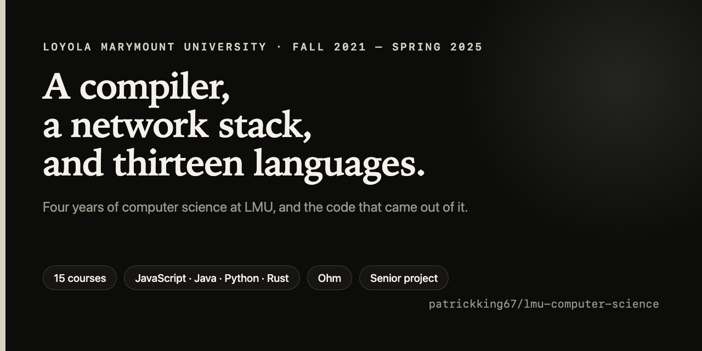

# LMU Computer Science

[](https://github.com/patrickking67/lmu-computer-science/actions/workflows/site-data.yml)
[](LICENSE)

Four years of computer science at Loyola Marymount University, Fall 2021 to
Spring 2025, and the code that came out of it: a compiler, a network stack, a
senior project, and work in 18 languages.

**Live site: [patrickking67.github.io/lmu-computer-science](https://patrickking67.github.io/lmu-computer-science/)**

[](https://patrickking67.github.io/lmu-computer-science/)

BS Computer Science, Seaver College of Science and Engineering. Advised by
Dr. Ray Toal.

## Start here

| Project | Course | What it is |
|---|---|---|
| **CloudScribe** | [CMSI 3802](src/courses/cmsi-3802) | A statically typed language for the work that usually ends up in a fragile shell script, compiled to JavaScript in five stages from an Ohm grammar. 143 tests at 99.66% statement coverage, over a back end with two defects the suite never reached. [Run it in the browser](https://patrickking67.github.io/lmu-computer-science/programs/#cloudscribe). |
| **The network stack** | [CMSI 3550](src/courses/cmsi-3550) | Seven projects in Rust working down the stack: subnet arithmetic from bit operations, then sockets, then peer-to-peer file transfer with no server in the middle. |
| **Pathfinder** | [CMSI 4071](src/courses/cmsi-4071), [CMSI 4072](src/courses/cmsi-4072) | The senior project. Specified and defended in the first semester, built to that specification in the second: Vite and React, an Express API, Firebase Cloud Functions. |

## What the site does

- Runs the programs that fit in a browser tab. CloudScribe compiles in the page
  using the submitted compiler, unmodified; the compound interest calculator
  runs inline; myGainz opens in a StackBlitz tab. Nothing to clone.
- Lists every course by year and by language, with lines of code per language
  linked to the courses they were written in.
- Quotes source straight out of the tree at build time, so a snippet cannot
  drift from what is committed.
- Tests every claim it makes about this repository (paths, line ranges, counts,
  run modes) in CI.

## Quickstart

Needs Node 22.18 or later and Python 3.10 or later.

```bash
git clone git@github.com:patrickking67/lmu-computer-science.git
cd lmu-computer-science
python3 -m venv .venv && . .venv/bin/activate
python3 -m pip install -e src/packages/lmucs pytest
npm --prefix src/dashboard ci

npm --prefix src/dashboard run dev -- --port 4322   # http://localhost:4322/
./scripts/check.sh                                   # every fast, offline check
```

Build and test commands for the coursework itself (Java, Rust, the CMSI 3801
languages), with the version pins that make them work, are in
[`docs/building.md`](docs/building.md).

## Courses

Titles follow the [LMU Academic Bulletin](https://bulletin.lmu.edu/course-descriptions/cmsi/).

| Course | Title | Term | Work |
|---|---|---|---|
| [CMSI 1010](src/courses/cmsi-1010) | Computer Programming Laboratory | Fall 2021 | |
| [CMSI 1900](src/courses/cmsi-1900) | Exploring Computer Science | Fall 2021 | |
| [CMSI 2021](src/courses/cmsi-2021) | Web Application Development | Fall 2022 | myGainz, 3 web apps |
| [CMSI 2120](src/courses/cmsi-2120) | Data Structures and Applications | Spring 2022 | |
| [CMSI 2130](src/courses/cmsi-2130) | Algorithms and Analysis | Spring 2023 | 5 projects, Java |
| [CMSI 2210](src/courses/cmsi-2210) | Computer Systems Organization | Fall 2022 | |
| [CMSI 2820](src/courses/cmsi-2820) | Discrete Mathematics for Computer Science | Fall 2022 | |
| [CMSI 3300](src/courses/cmsi-3300) | Artificial Intelligence | Fall 2024 | inference and classification |
| [CMSI 3550](src/courses/cmsi-3550) | Networks and the Internet | Spring 2024 | 7 projects, Rust |
| [CMSI 3751](src/courses/cmsi-3751) | Game Design | Fall 2023 | |
| [CMSI 3801](src/courses/cmsi-3801) | Theories of Computer and Human Languages | Fall 2024 | 13 languages, answer keys |
| [CMSI 3802](src/courses/cmsi-3802) | Programming Language Concepts and Implementation | Spring 2025 | CloudScribe, course material |
| [CMSI 3920](src/courses/cmsi-3920) | Computing Contexts and Ethics | Summer 2024 I | |
| [CMSI 4071](src/courses/cmsi-4071) | Senior Project I | Fall 2024 | design and specification |
| [CMSI 4072](src/courses/cmsi-4072) | Senior Project II | Spring 2025 | Pathfinder, deliverable set |

Fifteen courses, thirteen of which produced a repository: CMSI 1900 was a
zero-unit seminar and CMSI 3920 a summer session, so their directories hold a
README and nothing else. Eight produced code you can read here. Terms come from
the course audit rather than instructor course pages, which publish whichever
offering happens to be current; all four checked disagreed with the enrolment
term.

The full course record is in [`docs/record.md`](docs/record.md), and
`lmucs verify` checks this tree against it in both directions.

## Still going

Projects that outlived the course that started them.

| Repository | Visibility | Relation |
|---|---|---|
| [`cloudscribe`](https://github.com/patrickking67/cloudscribe) | public | The language and its compiler, developed past the course snapshot. Started in CMSI 3802. |
| [`pathfinder`](https://github.com/patrickking67/pathfinder) | private | The senior project, being rebuilt as a product. |
| [`myGainz`](https://github.com/patrickking67/myGainz) | public | A training log that keeps the set-by-set history most workout apps discard. React and Firestore. Started in CMSI 2021. |

## How it is put together

```text
lmu-computer-science/
├── src/
│   ├── courses/            fifteen course directories, cmsi-1010 to cmsi-4072, as submitted
│   ├── packages/lmucs/     Python package that reads and verifies the record, counts lines
│   └── dashboard/          the site: Astro 7, Tailwind 4, static, GitHub Pages
├── docs/                   course record, build commands, reference notes, publication record
├── tests/                  site-data.test.mjs: the site's claims, checked against the tree
├── scripts/                check.sh (everything) and check-ai-config.sh (the repository check)
├── llms.txt                summary for language models, also served at the site root
├── AGENTS.md               canonical guide for coding agents
└── .github/workflows/      Pages deploy, site data, Conda package, repository check
```

Coursework under `src/courses/` is never edited. Dated code and recorded
defects are the correct state there; `docs/building.md` documents them. The
site reads coursework at build time through `src/dashboard/src/lib/repo.ts` and
writes nothing back.

## Tests

```bash
./scripts/check.sh              # all of the below, then the site build
./scripts/check.sh --no-build   # skip the build
```

That runs, in order:

- `scripts/check-ai-config.sh`: required files, adapter wiring, no tracked build
  artifacts, compiled binaries or credentials, no coursework hidden by a
  `.gitignore` rule, all fifteen courses documented. Also run in CI on Ubuntu
  and on macOS under bash 3.2.
- `node --test "tests/*.test.mjs"`: every path, line range, count, run mode and
  link the site and `llms.txt` publish, checked against the tree.
- `pytest` in `src/packages/lmucs`: the record parser and the line counter.
- `npm run build` in `src/dashboard`.

The published counts come from the package:

```bash
lmucs summary    # courses, credits, terms
lmucs verify     # the record against the tree, both directions
lmucs stats      # lines of coursework by language
```

## By the numbers

Counted by `lmucs stats` over tracked files under `src/courses`, lockfiles excluded.

| | |
|---|---|
| Courses | 15, of which 13 produced a repository |
| Lines of coursework | 15,950 |
| Languages | 18 |
| Largest | JavaScript (5,542), Java (4,427), Rust (743) |
| Smallest that still ships | CloudScribe (113), Assembly (30) |

## Deploy

Every push to `main` builds `src/dashboard` and deploys it to GitHub Pages
(`.github/workflows/pages.yml`). The workflow passes the Pages origin and base
path to the build, so the same source works at a domain root and at
`/lmu-computer-science/`.

## Contributing and security

This is a personal archive; contributions are limited to fixes. See
[`CONTRIBUTING.md`](CONTRIBUTING.md). Report security problems privately as
described in [`SECURITY.md`](SECURITY.md). Changes are recorded in
[`CHANGELOG.md`](CHANGELOG.md). Instructor course material is indexed in
[`docs/reference.md`](docs/reference.md), and
[`docs/publication.md`](docs/publication.md) records what publishing this
accepted.

## About

Patrick King. BS Computer Science, minor in Business Administration, Loyola
Marymount University.
[LinkedIn](https://www.linkedin.com/in/patrickgking03/) ·
[GitHub](https://github.com/patrickking67)

## License

MIT. See [LICENSE](LICENSE).
