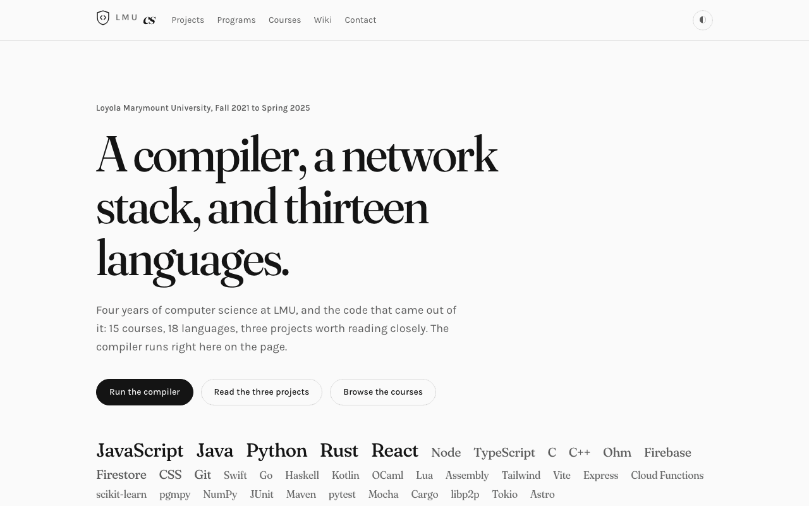
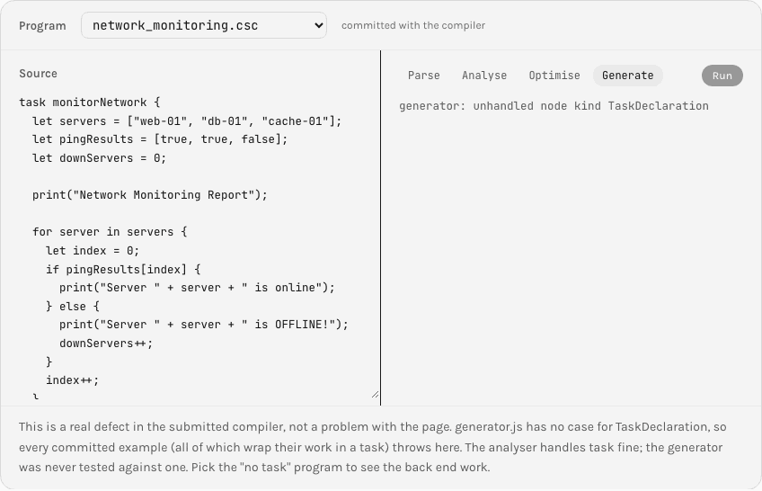
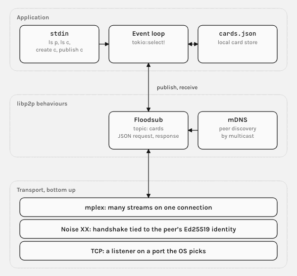
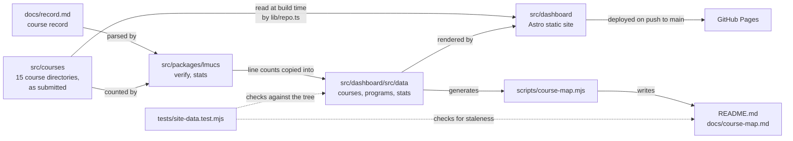
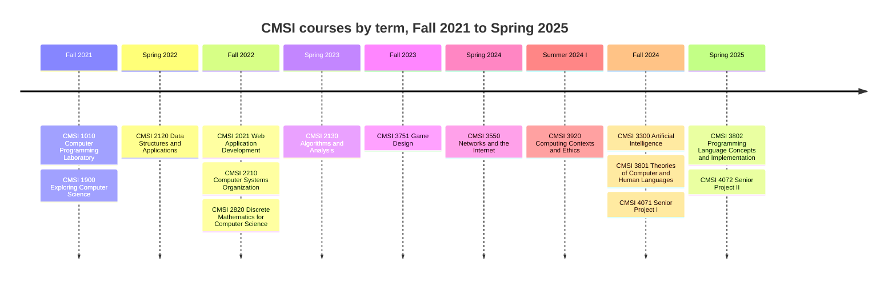

# LMU Computer Science

Four years of computer science coursework at Loyola Marymount University, Fall 2021 to
Spring 2025, kept as submitted and presented by a site that runs some of it in the
browser: a compiler, a peer-to-peer network in Rust, a senior project, and work in 18
languages.

[](https://github.com/patrickking67/lmu-computer-science/actions/workflows/site-data.yml)
[](LICENSE)
[](https://patrickking67.github.io/lmu-computer-science/)

<a href="https://patrickking67.github.io/lmu-computer-science/">
  <picture>
    <source media="(prefers-color-scheme: dark)" srcset="docs/assets/home-dark.png">
    
  </picture>
</a>

## Try it

**Live: [patrickking67.github.io/lmu-computer-science](https://patrickking67.github.io/lmu-computer-science/)**.
The [front page](https://patrickking67.github.io/lmu-computer-science/#run) runs the
CloudScribe compiler on whatever you type. Or locally, with Node 22.18+ and Python 3.10+:

```bash
git clone git@github.com:patrickking67/lmu-computer-science.git && cd lmu-computer-science
python3 -m venv .venv && . .venv/bin/activate
python3 -m pip install -e src/packages/lmucs pytest && npm --prefix src/dashboard ci
npm --prefix src/dashboard run dev -- --port 4322   # http://localhost:4322/
./scripts/check.sh                                   # every check, then the site build
```

## Three projects

### CloudScribe, a compiler

<picture>
  <source media="(prefers-color-scheme: dark)" srcset="docs/assets/playground-dark.png">
  
</picture>

A statically typed language for IT automation, compiled to JavaScript in four stages
from an Ohm grammar. Built with one partner in CMSI 3802. **What was hard:** rejecting a
bad program with a line and column before any output exists; the static analyzer is 462
of the compiler's 1,040 lines. The screenshot shows the other half of the story: 143
tests at 99.66% statement coverage, and a generator that cannot compile the language's
own `task` construct.

[Case study](https://patrickking67.github.io/lmu-computer-science/projects/cloudscribe/) ·
[Run it](https://patrickking67.github.io/lmu-computer-science/programs/#cloudscribe) ·
[Code](src/courses/cmsi-3802/cloudscribe)

### The network stack, in Rust

<picture>
  <source media="(prefers-color-scheme: dark)" srcset="docs/assets/network-dark.png">
  
</picture>

Seven Rust projects in CMSI 3550, from subnet arithmetic with bit operations to a final
team project: a trading card network on libp2p where peers find each other by mDNS and
talk over TCP, Noise and mplex with no server. **What was hard:** getting request and
response out of Floodsub, which only broadcasts. Every reply names the peer it is for,
and every other peer drops it.

[Case study](https://patrickking67.github.io/lmu-computer-science/projects/network-stack/) ·
[Code](src/courses/cmsi-3550) ·
[The peer](src/courses/cmsi-3550/Final/src/main.rs)

### Pathfinder, the senior project


A career guidance web app: a questionnaire, a chat coach, a resume reviewer and a
salary estimator behind one sign-in. Specified in CMSI 4071, built in CMSI 4072 by a
team of four; I was project manager. React and Vite, Firebase Auth, an Express API,
Cloud Functions. **What was hard:** holding a four-person build to a specification
written a semester earlier, and keeping the app answering when the model call fails.

[Case study](https://patrickking67.github.io/lmu-computer-science/projects/pathfinder/) ·
[Code](src/courses/cmsi-4072/Pathfinder) ·
[Design documents](src/courses/cmsi-4072/Senior%20Project%20Deliverables)

## What is technically interesting here

- **A submitted compiler runs in the page, unmodified.** The site imports the course's
  `analyzer.js`, `optimizer.js` and `generator.js` straight from `src/courses` and
  substitutes one thing a browser cannot do, a file read for the grammar.
  [`lib/cloudscribe.ts`](src/dashboard/src/lib/cloudscribe.ts)
- **High coverage hid two defects, and tests now pin them.** The coursework is never
  repaired, so the defects are asserted to still exist; a quiet fix fails CI.
  [`tests/site-data.test.mjs`](tests/site-data.test.mjs),
  [`docs/building.md`](docs/building.md#cmsi-3802-the-compilers-back-end-is-broken-and-the-tests-do-not-show-it)
- **Request and response over a broadcast protocol.** One `tokio::select!` loop handles
  stdin, outgoing replies and swarm events.
  [`Final/src/main.rs`](src/courses/cmsi-3550/Final/src/main.rs)
- **Numbers are generated or tested, never typed.** Line counts come from a counter over
  tracked files; the course map below is generated from the site's data, and a test
  fails when either is stale.
  [`scripts/course-map.mjs`](scripts/course-map.mjs),
  [`lmucs/stats.py`](src/packages/lmucs/lmucs/stats.py)
- **A security policy that was measured, not assumed.** The page carries no `script-src`
  because a sandboxed `srcdoc` frame inherits it and the playground's script is
  generated from user input. Visitor code runs in an opaque-origin iframe instead.
  [`Base.astro`](src/dashboard/src/layouts/Base.astro)
- **A check that checked nothing, found and fixed.** The recorded Swift command exited 0
  without running the 68 assertions.
  [`docs/building.md`](docs/building.md#the-swift-command-used-to-verify-nothing)

## Architecture



Coursework flows one way: it is read by the counter and the site build, and nothing
writes back. [`docs/architecture.md`](docs/architecture.md) has five more diagrams: how
the courses build on each other, one per project drawn from its code, and the browser
playground as a sequence.

## Course map

<!-- course-map:start (generated by scripts/course-map.mjs) -->
15 courses over 9 terms, Fall 2021 to Spring 2025. 7 of them hold counted code: 15,950 lines in 18 languages.

| Term | Course | Title | Lines | Languages |
|---|---|---|---:|---|
| Fall 2021 | [CMSI 1010](src/courses/cmsi-1010) | Computer Programming Laboratory |  |  |
| Fall 2021 | [CMSI 1900](src/courses/cmsi-1900) | Exploring Computer Science |  |  |
| Spring 2022 | [CMSI 2120](src/courses/cmsi-2120) | Data Structures and Applications |  |  |
| Fall 2022 | [CMSI 2021](src/courses/cmsi-2021) | Web Application Development | 1,252 | JavaScript, CSS, HTML |
| Fall 2022 | [CMSI 2210](src/courses/cmsi-2210) | Computer Systems Organization |  |  |
| Fall 2022 | [CMSI 2820](src/courses/cmsi-2820) | Discrete Mathematics for Computer Science |  |  |
| Spring 2023 | [CMSI 2130](src/courses/cmsi-2130) | Algorithms and Analysis | 4,079 | Java |
| Fall 2023 | [CMSI 3751](src/courses/cmsi-3751) | Game Design |  |  |
| Spring 2024 | [CMSI 3550](src/courses/cmsi-3550) | Networks and the Internet | 1,096 | Rust, JavaScript, CSS, HTML |
| Summer 2024 I | [CMSI 3920](src/courses/cmsi-3920) | Computing Contexts and Ethics |  |  |
| Fall 2024 | [CMSI 3300](src/courses/cmsi-3300) | Artificial Intelligence | 335 | Python |
| Fall 2024 | [CMSI 3801](src/courses/cmsi-3801) | Theories of Computer and Human Languages | 3,065 | C, Java, TypeScript, Swift, JavaScript, Kotlin, Lua, Python, OCaml, Haskell, Go, C++, Rust |
| Fall 2024 | [CMSI 4071](src/courses/cmsi-4071) | Senior Project I |  |  |
| Spring 2025 | [CMSI 3802](src/courses/cmsi-3802) | Programming Language Concepts and Implementation | 3,125 | JavaScript, CSS, Ohm, HTML, CloudScribe, Assembly |
| Spring 2025 | [CMSI 4072](src/courses/cmsi-4072) | Senior Project II | 2,998 | JavaScript, CSS, HTML |



<details>
<summary>Language by course: lines in each of the 18 languages, per course</summary>

Lines in tracked files under `src/courses`, by course directory, lockfiles excluded. Columns are CMSI course numbers. Counted by `lmucs stats`; an empty cell means no file in that language.

| Language | 2021 | 2130 | 3300 | 3550 | 3801 | 3802 | 4072 | Total |
|---|---:|---:|---:|---:|---:|---:|---:|---:|
| JavaScript | 911 |  |  | 253 | 282 | 2,418 | 1,678 | 5,542 |
| Java |  | 4,079 |  |  | 348 |  |  | 4,427 |
| CSS | 188 |  |  | 120 |  | 213 | 1,265 | 1,786 |
| Rust |  |  |  | 663 | 80 |  |  | 743 |
| Python |  |  | 335 |  | 219 |  |  | 554 |
| HTML | 153 |  |  | 60 |  | 170 | 55 | 438 |
| C |  |  |  |  | 355 |  |  | 355 |
| TypeScript |  |  |  |  | 322 |  |  | 322 |
| Swift |  |  |  |  | 318 |  |  | 318 |
| Kotlin |  |  |  |  | 268 |  |  | 268 |
| Lua |  |  |  |  | 248 |  |  | 248 |
| OCaml |  |  |  |  | 204 |  |  | 204 |
| Ohm |  |  |  |  |  | 181 |  | 181 |
| Haskell |  |  |  |  | 170 |  |  | 170 |
| Go |  |  |  |  | 135 |  |  | 135 |
| C++ |  |  |  |  | 116 |  |  | 116 |
| CloudScribe |  |  |  |  |  | 113 |  | 113 |
| Assembly |  |  |  |  |  | 30 |  | 30 |
| **Total** | **1,252** | **4,079** | **335** | **1,096** | **3,065** | **3,125** | **2,998** | **15,950** |

</details>
<!-- course-map:end -->

Terms come from the course audit, not instructor course pages. Eight course
directories hold only a README: the work was not preserved, or the course produced
none. The full record is [`docs/record.md`](docs/record.md), and `lmucs verify` checks the tree
against it in both directions.

## Quality signals

| Signal | Current state |
|---|---|
| Site-data tests | 36, checking every path, line range, count and link the site publishes |
| Package tests | 24 in `lmucs`, the record parser and line counter |
| Course suites | 17 run by 2026-11-12, 15 clean and 2 failing for recorded reasons (Lua 5.5 rejects the submitted module; one Rust crate was submitted unfinished). Toolchain versions in [`docs/building.md`](docs/building.md) |
| Not run | The CMSI 2130 Java projects (no build file, no JUnit on the machine), the CMSI 3300 harnesses and the React front ends |
| CI | `scripts/check.sh` on every pull request; the repository check on Ubuntu and macOS (bash 3.2) |
| Security checks | No tracked credentials, compiled binaries or build output; narrow CSP; sandboxed execution |
| Accessibility | Checked by hand at 1280 and 375 pixels in both themes; no automated audit |

## Layout and checks

```text
src/courses/            fifteen course directories, cmsi-1010 to cmsi-4072, as submitted
src/packages/lmucs/     Python package: verifies the record, counts lines
src/dashboard/          the site: Astro 7, Tailwind 4, static
docs/                   architecture, build matrix, course record, publication record
tests/                  site-data.test.mjs: the site's claims, checked against the tree
scripts/                check.sh, check-ai-config.sh, course-map.mjs
```

`./scripts/check.sh` runs the repository check, the site-data tests, the `lmucs` tests
and the site build; `--no-build` skips the last. Coursework under `src/courses` is never
edited, so dated code and recorded defects are the correct state there. After changing
site data, run `node scripts/course-map.mjs` to regenerate the course map.

## Deploy

Every push to `main` builds `src/dashboard` and deploys it to GitHub Pages
([`pages.yml`](.github/workflows/pages.yml)). The workflow passes the Pages origin and
base path to the build, so the same source works at a domain root and under
`/lmu-computer-science/`.

## More

[`AGENTS.md`](AGENTS.md) is the working guide. [`CONTRIBUTING.md`](CONTRIBUTING.md),
[`SECURITY.md`](SECURITY.md) and [`CHANGELOG.md`](CHANGELOG.md) cover the rest.
[`docs/publication.md`](docs/publication.md) records what publishing this accepted.
Three projects continue in their own repositories:
[`cloudscribe`](https://github.com/patrickking67/cloudscribe) (public),
[`myGainz`](https://github.com/patrickking67/myGainz) (public) and `pathfinder` (private).

Patrick King. Advised by Dr. Ray Toal.
[GitHub](https://github.com/patrickking67) ·
[LinkedIn](https://www.linkedin.com/in/patrickgking03/)

## License

MIT. See [LICENSE](LICENSE).
