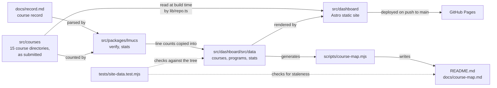
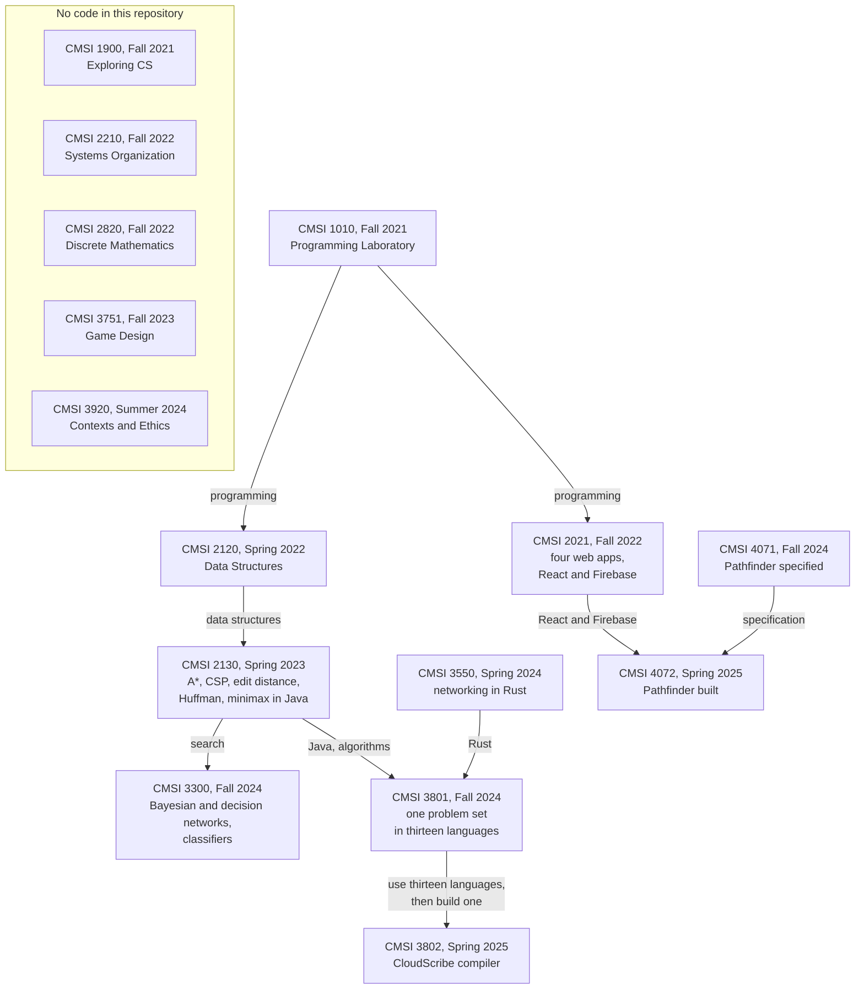
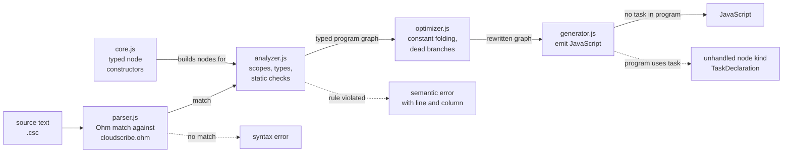
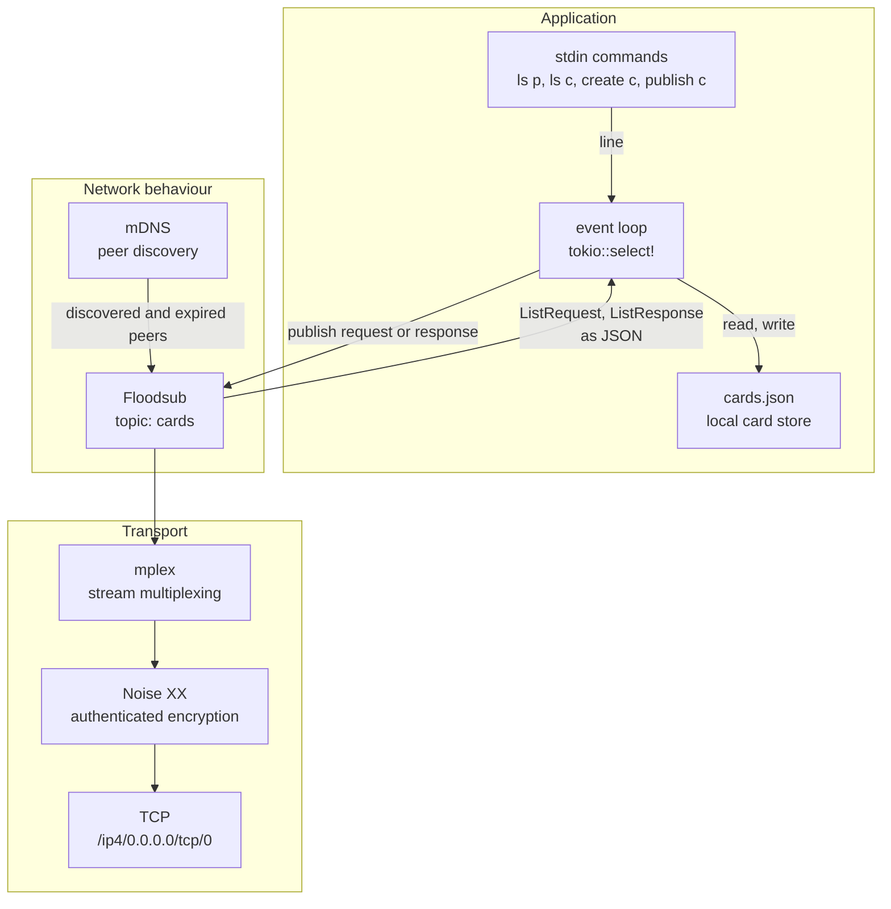
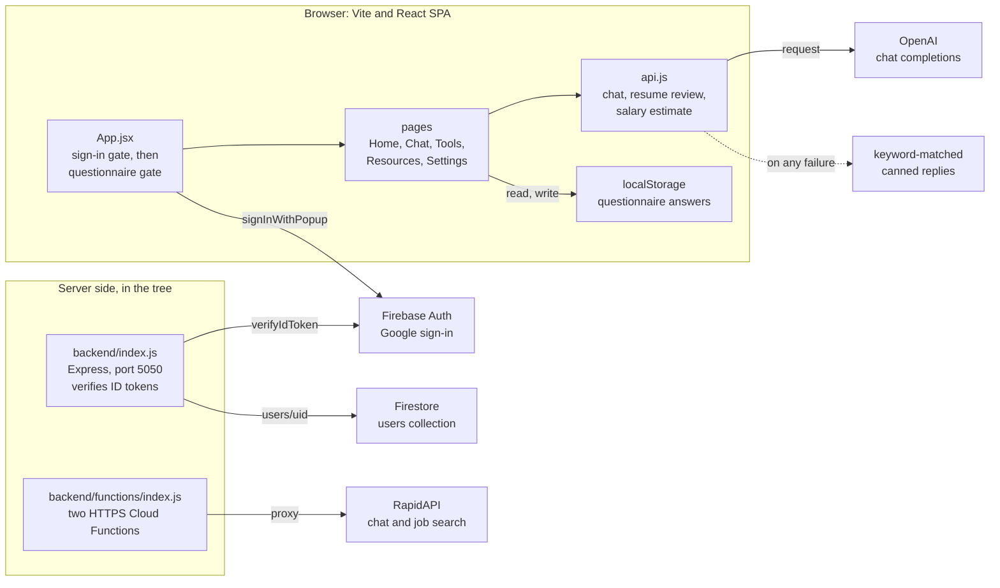
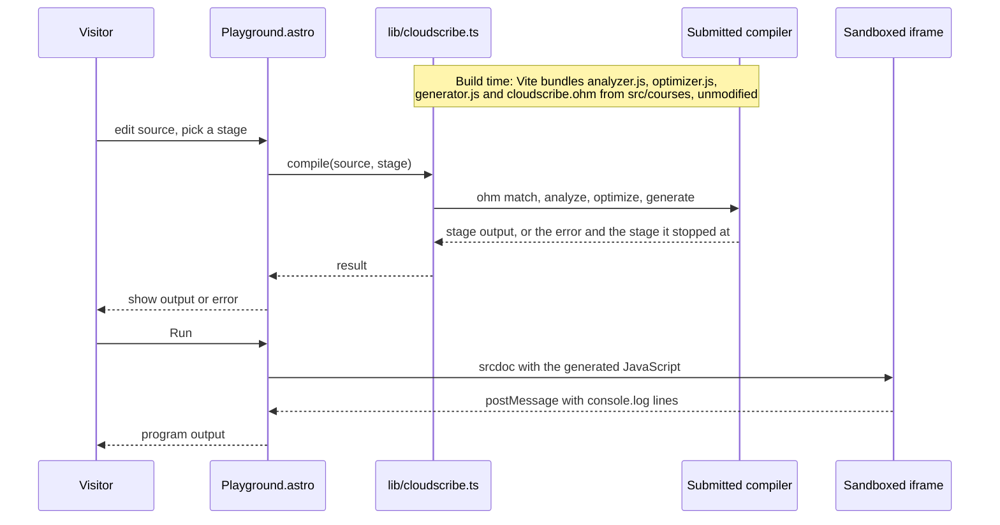

# Architecture

Six diagrams: how the repository is put together, how the courses build on each other,
one for each of the three lead projects drawn from its code, and the mechanism that lets
the site run a submitted compiler in a browser tab.

Every diagram names files that exist. `tests/site-data.test.mjs` checks the paths and
course codes on this page against the tree, so a rename breaks a test instead of
leaving a diagram wrong.

## 1. The repository

Coursework flows one way. `src/courses` is read by the line counter and by the site
build, and nothing writes back to it. The dotted edges are the checks: the test file
re-runs the count and regenerates the course map, then fails if the committed copies
differ.

## 2. How the courses build on each other

Edges show what a later course reused from an earlier one, read from the code in this
repository and the order the courses were taken. They are not the catalog's
prerequisite list. Two chains end in lead projects: 1010, 2120, 2130, 3801, 3802
produced the compiler, and Pathfinder in 4072 was built to the 4071 specification on
the React and Firebase stack first used in 2021. The five courses in the box left
nothing countable here, so no edge can be drawn from evidence. The strict term-by-term
list is generated in [`course-map.md`](course-map.md).

## 3. CloudScribe: the compiler pipeline

Source: [`src/courses/cmsi-3802/cloudscribe/src`](../src/courses/cmsi-3802/cloudscribe/src).

`compiler.js` runs the four stages in order and can stop after any of them, which is
what the `parsed`, `analyzed`, `optimized` and `js` output types are. The front end is
the strong half: the analyzer is 462 of the 1,040 lines in `src` and carries the scope
chain and every static rule. The last dotted edge is a recorded defect, not a design:
the generator has no case for `task`, the construct every committed example is wrapped
in. [`building.md`](building.md) has the detail, and a second defect in the optimizer.

## 4. The network project: a libp2p stack

Source: [`src/courses/cmsi-3550/Final/src/main.rs`](../src/courses/cmsi-3550/Final/src/main.rs).

Read it bottom to top: a TCP socket on an OS-assigned port, upgraded with a Noise XX
handshake keyed by the peer's Ed25519 identity, then multiplexed with mplex. On top of
that sit two libp2p behaviours. mDNS finds peers on the local network by multicast,
outside this TCP stack, and feeds them into Floodsub's view, and Floodsub carries the application protocol: a JSON
`ListRequest` goes out on the `cards` topic and each peer answers with a `ListResponse`
addressed to the requester, holding only the cards marked public. There is no server.
One `tokio::select!` loop multiplexes stdin, the response channel and swarm events.

## 5. Pathfinder: components as submitted

Source: [`src/courses/cmsi-4072/Pathfinder`](../src/courses/cmsi-4072/Pathfinder).

Two things to notice. First, the gate order in `App.jsx` is the product's whole flow:
no user, sign in; no questionnaire, fill it in; otherwise the five pages. Second, the
two server pieces have no inbound edge from the browser. As submitted, the front end
calls OpenAI directly with a placeholder key and falls back to canned replies, the
questionnaire lives in `localStorage`, and nothing in `frontend/src` calls the Express
API or the Cloud Functions. The diagram draws what the code does, not what the design
document intended.

## 6. The mechanism: a submitted compiler running in the page

Source: [`src/dashboard/src/lib/cloudscribe.ts`](../src/dashboard/src/lib/cloudscribe.ts)
and [`src/dashboard/src/components/Playground.astro`](../src/dashboard/src/components/Playground.astro).

The page does not reimplement the compiler. It imports the three submitted stage files
and the grammar straight out of `src/courses` and substitutes exactly one thing: the
submitted `parser.js` loads the grammar with `fs.readFileSync`, which a browser cannot
do, so the grammar text is bundled and matched directly. Generated JavaScript runs in
an iframe with `sandbox="allow-scripts"` and an opaque origin, and its only way out is
a `postMessage` of printed lines. That is also why the page cannot carry a `script-src`
policy: a sandboxed `srcdoc` frame inherits it, and the script is generated from what
the visitor typed.
