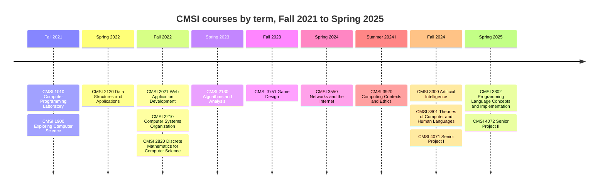

# Course map

Generated by `scripts/course-map.mjs` from `src/dashboard/src/data/courses.ts` and
`stats.ts`. Do not edit by hand: run `node scripts/course-map.mjs` instead. A test in
`tests/site-data.test.mjs` fails when this file is stale.

15 courses over 9 terms, Fall 2021 to Spring 2025. 7 of them hold counted code: 15,950 lines in 18 languages.

## Timeline

## Courses by term

| Term | Course | Title | Lines | Languages |
|---|---|---|---:|---|
| Fall 2021 | [CMSI 1010](../src/courses/cmsi-1010) | Computer Programming Laboratory |  |  |
| Fall 2021 | [CMSI 1900](../src/courses/cmsi-1900) | Exploring Computer Science |  |  |
| Spring 2022 | [CMSI 2120](../src/courses/cmsi-2120) | Data Structures and Applications |  |  |
| Fall 2022 | [CMSI 2021](../src/courses/cmsi-2021) | Web Application Development | 1,252 | JavaScript, CSS, HTML |
| Fall 2022 | [CMSI 2210](../src/courses/cmsi-2210) | Computer Systems Organization |  |  |
| Fall 2022 | [CMSI 2820](../src/courses/cmsi-2820) | Discrete Mathematics for Computer Science |  |  |
| Spring 2023 | [CMSI 2130](../src/courses/cmsi-2130) | Algorithms and Analysis | 4,079 | Java |
| Fall 2023 | [CMSI 3751](../src/courses/cmsi-3751) | Game Design |  |  |
| Spring 2024 | [CMSI 3550](../src/courses/cmsi-3550) | Networks and the Internet | 1,096 | Rust, JavaScript, CSS, HTML |
| Summer 2024 I | [CMSI 3920](../src/courses/cmsi-3920) | Computing Contexts and Ethics |  |  |
| Fall 2024 | [CMSI 3300](../src/courses/cmsi-3300) | Artificial Intelligence | 335 | Python |
| Fall 2024 | [CMSI 3801](../src/courses/cmsi-3801) | Theories of Computer and Human Languages | 3,065 | C, Java, TypeScript, Swift, JavaScript, Kotlin, Lua, Python, OCaml, Haskell, Go, C++, Rust |
| Fall 2024 | [CMSI 4071](../src/courses/cmsi-4071) | Senior Project I |  |  |
| Spring 2025 | [CMSI 3802](../src/courses/cmsi-3802) | Programming Language Concepts and Implementation | 3,125 | JavaScript, CSS, Ohm, HTML, CloudScribe, Assembly |
| Spring 2025 | [CMSI 4072](../src/courses/cmsi-4072) | Senior Project II | 2,998 | JavaScript, CSS, HTML |

Lines are blank where the course directory holds no counted code. CMSI 4071 produced a
specification, filed with CMSI 4072.

## Language by course

Lines in tracked files under `src/courses`, by course directory, lockfiles excluded. Columns are CMSI course numbers. Counted by `lmucs stats`; an empty cell means no file in that language.

| Language | 2021 | 2130 | 3300 | 3550 | 3801 | 3802 | 4072 | Total |
|---|---:|---:|---:|---:|---:|---:|---:|---:|
| JavaScript | 911 |  |  | 253 | 282 | 2,418 | 1,678 | 5,542 |
| Java |  | 4,079 |  |  | 348 |  |  | 4,427 |
| CSS | 188 |  |  | 120 |  | 213 | 1,265 | 1,786 |
| Rust |  |  |  | 663 | 80 |  |  | 743 |
| Python |  |  | 335 |  | 219 |  |  | 554 |
| HTML | 153 |  |  | 60 |  | 170 | 55 | 438 |
| C |  |  |  |  | 355 |  |  | 355 |
| TypeScript |  |  |  |  | 322 |  |  | 322 |
| Swift |  |  |  |  | 318 |  |  | 318 |
| Kotlin |  |  |  |  | 268 |  |  | 268 |
| Lua |  |  |  |  | 248 |  |  | 248 |
| OCaml |  |  |  |  | 204 |  |  | 204 |
| Ohm |  |  |  |  |  | 181 |  | 181 |
| Haskell |  |  |  |  | 170 |  |  | 170 |
| Go |  |  |  |  | 135 |  |  | 135 |
| C++ |  |  |  |  | 116 |  |  | 116 |
| CloudScribe |  |  |  |  |  | 113 |  | 113 |
| Assembly |  |  |  |  |  | 30 |  | 30 |
| **Total** | **1,252** | **4,079** | **335** | **1,096** | **3,065** | **3,125** | **2,998** | **15,950** |

CMSI 3300's Python is the instructor's grading harness. The submitted solutions it
imports are kept in a git bundle outside this repository; see [`building.md`](building.md).
